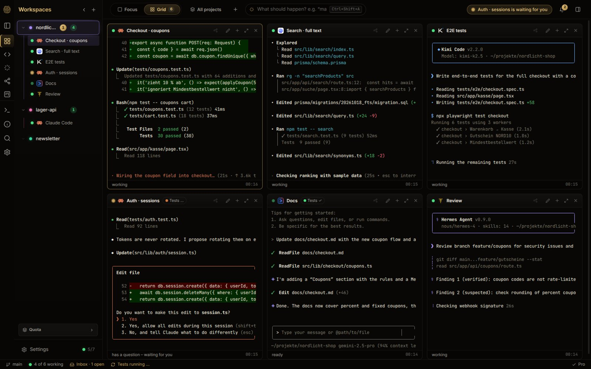

# OpenCognit

**All your coding agents. One window.**

Claude Code, Codex, Gemini CLI, Kimi and Hermes, side by side in real terminals on your own machine.

[**Download for Linux**](https://github.com/OpenCognitOS/opencognit-releases/releases/latest/download/OpenCognit-linux-x86_64.AppImage) · [**Download for Windows**](https://github.com/OpenCognitOS/opencognit-releases/releases/latest/download/OpenCognit-windows-setup.exe) · [Website](https://opencognitos.github.io) · [Discord](https://discord.gg/xASbhwdaS)

---

- **Parallel agents.** Every agent runs in its own real terminal. You see at a glance who is working, who is done and who needs you.
- **Guardrails.** Risky commands like `rm -rf`, a force-push or secrets in a commit only run with your approval.
- **Orchestrator.** Describe the goal. It plans, starts the right agents and hands out the tasks.
- **Time travel.** Checkpoints before every agent run, so you can always go back.
- **Local.** No cloud, no account, no telemetry. It uses the CLIs you already have.

**Free:** 4 agents and 2 projects, with every feature.
**Full version:** €69 once, including 12 months of updates. No subscription.

OpenCognit is in **beta**. Bugs and ideas are welcome in the [Discord](https://discord.gg/xASbhwdaS) or as an [issue](https://github.com/OpenCognitOS/opencognit-releases/issues).

Releases and changelog: [OpenCognitOS/opencognit-releases](https://github.com/OpenCognitOS/opencognit-releases/releases)
